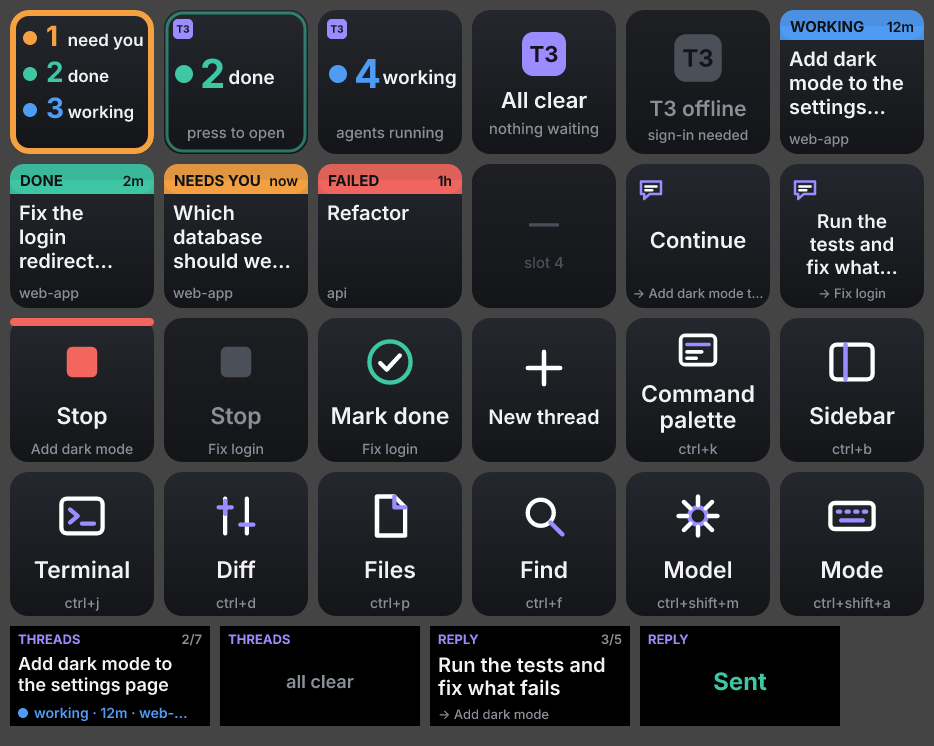
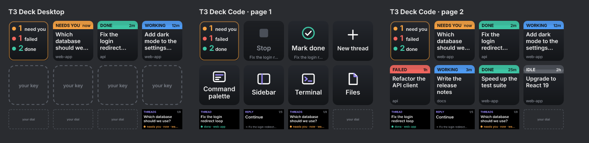
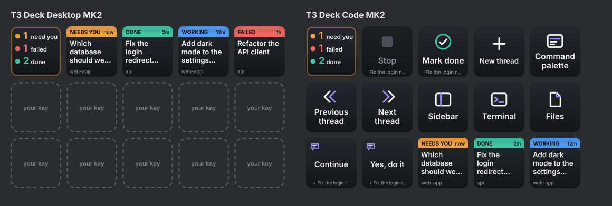
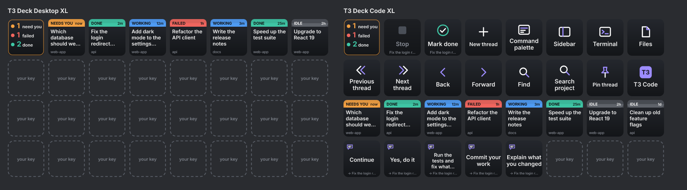

# T3 Deck

A Stream Deck plugin for [T3 Code](https://github.com/pingdotgg/t3code). Your coding agents on
physical keys:

- **See every thread at a glance.** Which threads need you (a question or an approval), failed,
  finished or are still working. Updates the moment T3 Code does; nothing polls.
- **Act without switching windows.** Open a thread, send a quick reply ("Continue", "Yes, do it"),
  stop a run, mark a thread done, start a new one, press any T3 Code shortcut.
- **The deck follows the program in front.** T3 Code gets the *T3 Deck Code* profile; every other
  program gets *T3 Deck Desktop*, which keeps a status key and your own keys.



There are no approve or deny keys on purpose: approvals are worth reading on screen. The status
key still lights up when a thread waits for you.

> T3 Deck is a community project. It is not made by or affiliated with the T3 Code team or Elgato.

## Requirements

- Windows 10 or 11 (switching by program and T3's shortcuts use a small Windows helper)
- Stream Deck app 7.1 or newer
- T3 Code, started at least once
- Any Stream Deck. Ready-made profiles for the **Stream Deck +**, **MK.2** (and other 15-key
  decks) and **XL**. On other models, drag the keys onto your own profiles.

## Install

1. Download `com.coreloop.t3.streamDeckPlugin` from the
   [latest release](https://github.com/maxzinko/t3-deck/releases/latest) and double-click it.
2. Let the Stream Deck app add the T3 Deck profiles when it asks.
3. Open the **T3 Status** key's settings. The **Setup** list checks each step (T3 Code found and
   running, access token, thread links, window watcher, your decks) and says how to fix any that
   fail.

On first start the plugin asks T3 Code for its own access token (see [Privacy](#privacy)). There is
nothing to copy or paste.

## The profiles

The empty slots on *T3 Deck Desktop* are for your own keys: volume, mute, a clock, whatever you
use all day. They stay when the deck switches.

**Stream Deck +** (4x2 keys, 4 dials). Swipe the touch strip to change pages.



**Stream Deck MK.2** (5x3 keys). No dials, so thread keys and two quick replies take their place.



**Stream Deck XL** (8x4 keys).



## The keys

- **T3 Status.** Counts threads that need you, failed, finished but not read yet, and working. The
  ring blinks when something new happened since you last pressed it. Press: open the thread that
  needs you most. Hold: open T3 Code.
- **Thread** (slot 1, 2, 3...). One thread from the list, most urgent first: needs you, failed,
  done, working, then the rest of your open threads. The same set as T3's sidebar: settled threads
  stay off until something new happens in them. Press: open it. Hold: mark it done.
- **Quick Reply.** Sends its text to the thread you looked at last. A thread that is still working
  gets it queued as its next turn, like T3's Queue. The bottom line shows where it goes. In its
  settings you can aim it at "the thread that needs you most" instead.
- **Stop.** Stops the current thread. Red while it's working.
- **Mark Done.** Settles the current thread.
- **New Thread.** T3's New chat shortcut. With a prompt in its settings, it opens a new draft with
  that prompt instead (T3 never sends a draft by itself).
- **Open T3 Code.** Brings T3 Code to the front, on the thread you looked at last.
- **T3 Shortcut.** Presses one of T3 Code's shortcuts: next/previous thread, command palette,
  sidebar, terminal, diff, find, files, model, mode, pin, settle and more. It reads your
  `keybindings.json`, so your own bindings win. It brings T3 Code to the front first and never
  sends keys to another program.

Dials (Stream Deck +):

- **Threads.** Turn through the list; the strip shows title, state, age and project. Press or
  touch: open. Long touch: mark done.
- **Reply.** Turn to pick a reply, press to send it to the current thread. Touch opens that thread
  so you can check first. The replies are a list in its settings, one per line.
- **Thread Navigator.** Turn: T3 Code's next / previous thread (only while T3 Code is in front).
  Press: mark the thread done. Touch: jump to the thread that needs you most.

## Switching by program

The **T3 Status** key's settings have the switch and the rules. One rule per line,
`program = profile [page]`, first match wins:

```
T3 Code*.exe = Code
obs64.exe = ignore        # OBS has its own profile: leave the deck alone
chrome.exe = Desktop 2    # a page number pins a program to a page
* = Desktop               # everything else, on the page you used last
```

`*` matches anything. `class:Name` matches a window class instead of a program. `ignore` leaves
the deck alone, for programs with their own Stream Deck profiles. Untick the switch to turn it off.

It switches only when you **change programs**. Moving between two Chrome windows, or passing
through Alt+Tab, the Start menu or the Stream Deck app, does nothing, so a profile you open by hand
stays until you really go to another program.

How it knows what's in front: `bin/fgwatch.exe`, a small C# helper ([source](native/fgwatch.cs))
built with the C# compiler that comes with Windows. It listens for "a window came to the front"
events (no polling) and quits with the plugin. It also presses T3's shortcuts and brings T3 Code to
the front, because Windows won't let a background program hand focus over.

## How it talks to T3 Code

- The same way T3 Code's own window does: a WebSocket to the local T3 server
  (`/ws?orchestrationProtocol=2`). The server pushes every thread change. The address comes from
  `~/.t3/userdata/server-runtime.json`, so a new port after an update is fine.
- Opening a thread uses T3's link `t3code://threads/<environment>/<thread>`.
- Commands it sends: `message.dispatch` (replies), `thread.stop`, `thread.settle`.
- T3 Code moves fast and its internal API changes. If an update breaks something, run the live
  checks under [Development](#development) and open an issue with what they print.

## Privacy

- On first start the plugin asks T3's own command line for a session:
  `t3 auth session issue --scope orchestration:read --scope orchestration:operate --ttl 30d --label "Stream Deck"`.
  It can read threads and send messages, nothing else (no settings, files or terminals). It renews
  itself a few days before it runs out. See or revoke it in T3 Code ▸ Settings ▸ Sharing & access.
- The token stays in the plugin's Stream Deck settings. The plugin never logs it or shows it to
  the settings page.
- Everything stays on your PC: the plugin only talks to the local T3 Code server.

## Troubleshooting

- **The Setup list** on the T3 Status key's settings page is the first place to look.
- **Keys say "T3 offline".** Start T3 Code; the keys reconnect within a few seconds.
- **Profiles don't switch.** Check the window watcher in the Setup list. Some antivirus programs
  block small unsigned helpers; allow `fgwatch.exe` and restart the Stream Deck app.
- **T3 Code or other apps won't start from the deck.** If you started the Stream Deck app from a
  T3 Code terminal, it inherited `ELECTRON_RUN_AS_NODE`. Quit it and start it from the Start menu.
- **Plugin log:** `%APPDATA%\Elgato\StreamDeck\Plugins\com.coreloop.t3.sdPlugin\logs\`.

## Development

Needs Node 24 and Windows 10/11.

```
npm install
npm run build          # the plugin folder com.coreloop.t3.sdPlugin, profiles included
npm test               # offline: fake Stream Deck, fake T3 Code, fake windows
npm run link           # link the plugin folder into the Stream Deck app (once)
npm run pack           # dist/com.coreloop.t3.streamDeckPlugin
npm run preview        # docs/keys.png and docs/layout-*.png
node test/live.mjs           # read-only: what the keys would show from your real T3 Code
node test/live-commands.mjs  # checks the command shapes against your real T3 (changes nothing)
```

After `npm run build`, restart the plugin (or the Stream Deck app) to load the new build. The
build skips the helper exe when it's up to date, and swaps it in when `native/fgwatch.cs` changes
while the plugin runs.

| Path | What |
| --- | --- |
| `src/t3.js` | WebSocket client, token, commands, thread state and the list order |
| `src/foreground.js` | Window watcher wrapper, app rules, profile switcher |
| `src/decks.js` | The deck models that get profiles |
| `src/actions.js` | Keys and dials |
| `src/render.js` | Key and touch-strip images (SVG, drawn with resvg) |
| `src/plugin.js` | Wiring, settings, setup checklist, opening links, shortcuts |
| `native/fgwatch.cs` | Foreground watcher, key presses, focus |
| `tools/` | Build and the profile generator (layouts for each deck) |
| `ui/` | Settings pages |
| `test/` | Offline tests, live checks, preview images |

Releases: bump `version` in `package.json`, add a section to `CHANGELOG.md`, push a tag `vX.Y.Z`.
GitHub Actions builds, tests and attaches the `.streamDeckPlugin` to the release.

Issues and pull requests are welcome. Please run `npm test` first.

## Credits

- [Inter](https://rsms.me/inter/) by Rasmus Andersson, SIL Open Font License (`assets/fonts/OFL.txt`)
- [resvg](https://github.com/linebender/resvg) (`@resvg/resvg-wasm`), Mozilla Public License 2.0
- [Stream Deck SDK](https://github.com/elgatosf/streamdeck) (`@elgato/streamdeck`), MIT

## License

[MIT](LICENSE)
